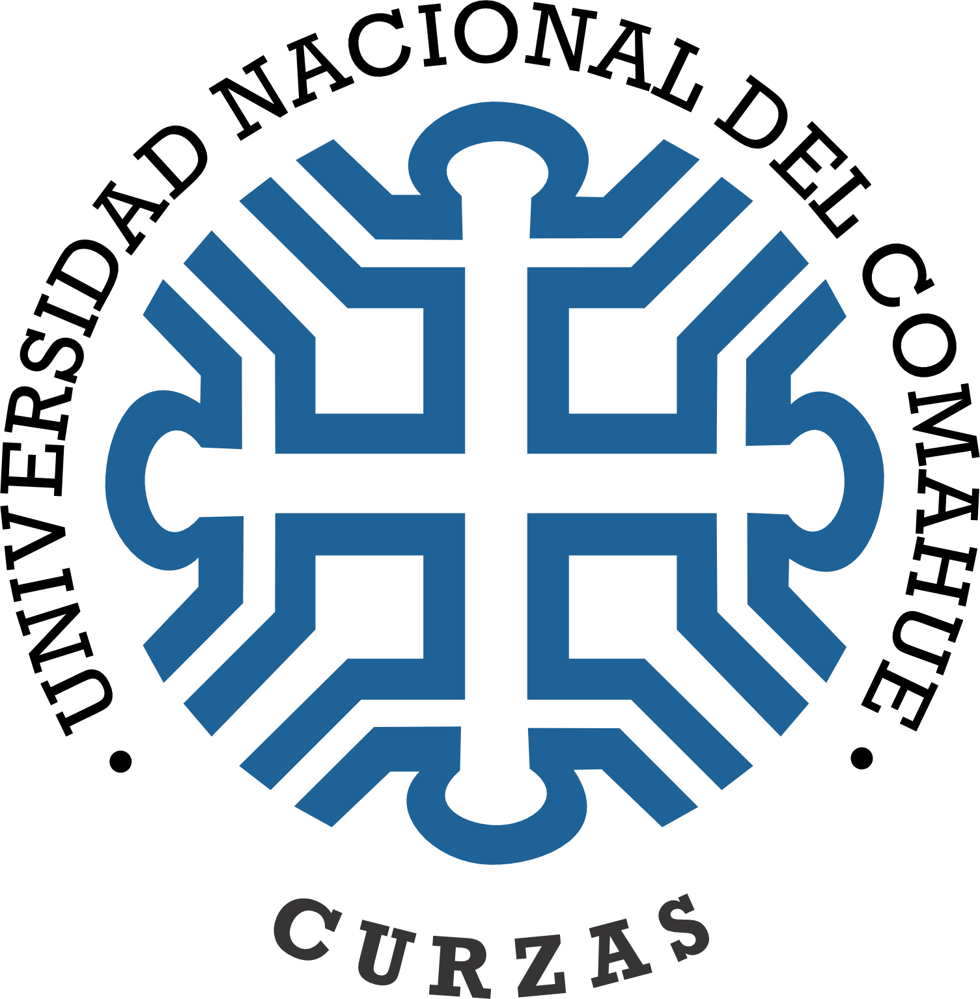

---
format:
  typst:
    paper: "presentation-16-9"
    include-before-body:
      - estilos_diapositivas.typ
---

# DIAPOSITIVA 1: Carátula Institucional y Presentación del Proyecto

::: {align="center"}
{width=65px}

**UNIVERSIDAD NACIONAL DEL COMAHUE** — *CURZAS / Depto. Administración Pública*  
[**DISEÑO DE UN SISTEMA DE EVALUACIÓN DEL DESEMPEÑO DOCENTE POR RETROALIMENTACIÓN DE 360° PARA LA MEJORA CONTINUA EN EL CURZAS - UNCO**]{style="color: #002B49; font-size: 11pt; font-weight: bold;"}  
*Diseño de Proyecto de Trabajo Final de Graduación — Resolución CD-CURZAS N° 266/23*
:::

:::: {.columns}
::: {.column width="50%"}
::: {.callout-note icon=false title="Trayectoria y Marco Académico"}
- **Tesista:** Tec. Sup. Héctor Daniel Ayarachi Fuentes *(Leg. 8252 — DNI 35.492.138)*
- **Carrera:** Licenciatura en Gestión de Recursos Humanos (C.C.C.)
- **Línea:** Gestión del Empleo Público y Desarrollo Humano en CURZAS
- **Punto de Partida:** Inquietud situada sobre el desarrollo pedagógico docente en Viedma y los 10 Nodos Territoriales.
:::
:::

::: {.column width="50%"}
::: {.callout-tip icon=false title="Cátedra y Tres Esquemas (Res. 266/23)"}
- **Equipo Docente Evaluador:**  
  Dra. Deborah Noguera *(Responsable)*,  
  Esp. Federico Abeiro & Esp. María Cecilia Aguirre *(Ayudantes)*
- **Estructura Oficial en 3 Esquemas:**  
  1°: Problema y Objetivos $\rightarrow$ 2°: Marco Teórico y Arte $\rightarrow$  
  3°: Estrategia Metodológica, Viabilidad y Cronograma.
:::
:::
::::

# DIAPOSITIVA 2: Esquema N° 1 — Delimitación del Problema y Objetivos

:::: {.columns}
::: {.column width="50%"}
::: {.callout-important icon=false title="El Problema en Contexto Situado"}
- **Lugar y Período:** CURZAS - Sede Viedma y 10 Nodos Territoriales (2024-2026 diagnóstico / 2027 aplicación piloto).
- **Tensión Crítica:** El régimen docente vigente (Ord. 021/04 y CCT 1246/15) opera con una lógica *exclusivamente sumativa y burocrática* (permanencia en el cargo cada 4 a 7 años).
- **Vacancia Institucional:** Ausencia de un dispositivo formativo continuo. Encuestas aisladas, sin pares ni articulación con la capacitación (Art. 76 CCT).
- **Pregunta Rectora:** *¿De qué manera un sistema de evaluación 360° contribuye al desarrollo pedagógico y al fortalecimiento institucional en 2027?*
:::
:::

::: {.column width="50%"}
::: {.callout-note icon=false title="Sistema y Matriz de Objetivos"}
**OBJETIVO GENERAL:**  
Diseñar una propuesta integral de evaluación del desempeño docente por retroalimentación 360° para la mejora continua en el CURZAS - UNCo.

**OBJETIVOS ESPECÍFICOS:**  
1. **Diagnosticar:** Percepciones docentes sobre el régimen actual (Ord. 021/04).
2. **Operacionalizar:** Identificar competencias pedagógicas y de gestión.
3. **Construir Arquitectura:** Diseñar rúbricas, ponderaciones y circuitos 360°.
4. **Formular Viabilidad:** Protocolo de prueba piloto para el ciclo lectivo 2027.
:::
:::
::::

# DIAPOSITIVA 3: Esquema N° 2 — Marco Teórico y Estado del Arte

:::: {.columns}
::: {.column width="55%"}
::: {.callout-note icon=false title="Núcleo Teórico y Posicionamiento Epistemológico"}
- **Enrique de la Garza Toledo:** *Trabajo no clásico*. La docencia universitaria es labor inmaterial, interactiva y de co-construcción de saberes.
- **Francisco Longo (2004):** *Sistema de Gestión de RRHH en Empleo Público*. Acoplamiento orgánico entre el Subsistema de Rendimiento y el de Desarrollo.
- **Modelo Multifuente 360°:** (Bernardin & Beatty; Lepsinger & Lucia).  
  Autoevaluación (20%) + Pares (30%) + Estudiantes (30%) + Dirección (20%).
- **Matus / Cao & Blutman / Oszlak:** Poligobernanza, poder compartido y construcción de *Capacidades Estatales* en burocracias profesionales.
:::
:::

::: {.column width="45%"}
::: {.callout-tip icon=false title="Antecedentes y Contexto Histórico"}
**ESTADO DEL ARTE Y VACANCIA:**  
- **Rueda Beltrán / Vaillant:** Evaluación formativa como motor de innovación didáctica universitaria.
- **Baroni et al. (2020):** Carrera docente en Universidades Nacionales.
- **Vacancia:** Nula literatura empírica sobre 360° en centros regionales periféricos con dispersión territorial.

**ESCENARIO HISTÓRICO 2024-2026:**  
Restricción fiscal, bimodalidad y expansión a la Región Sur.
:::
:::
::::

# DIAPOSITIVA 4: Esquema N° 3 — Estrategia Metodológica y Datos

:::: {.columns}
::: {.column width="48%"}
::: {.callout-note icon=false title="Diseño, Población y Muestra Justificada"}
- **Tipo de Estudio:** Aplicada propositiva. Proyecto de Desarrollo Institucional con *Estudio de Caso Situado* en CURZAS.
- **Enfoque Mixto:** Secuencial explicativo (**CUAL ➔ cuan**).  
  *Justificación:* Lo cualitativo inicial deconstruye resistencias; lo cuantitativo parametriza y valida rúbricas.
- **Población Total:** $N \approx 173$ sujetos (130 docentes en 3 Departamentos, 5 autoridades, 3 ADUNC, 35 estudiantes).
- **Muestra Cualitativa:** $n = 8$ informantes clave (máxima variación y criterio de saturación teórica).
- **Muestra Cuantitativa:** $n = 45$ docentes (muestreo estratificado por cuotas departamentales).
:::
:::

::: {.column width="52%"}
::: {.callout-tip icon=false title="Técnicas, Instrumentos y Rúbricas 360°"}
**TRIANGULACIÓN DE FUENTES:**  
1. **Análisis Documental:** Estatuto UNCo, Ord. 021/04 y CCT 1246/15.
2. **Entrevistas en Profundidad:** Guion validado por juicio de expertos.
3. **Cuestionarios Digitales:** Escala Likert de 5 puntos autoaplicada.
4. **Talleres de Co-diseño:** Validación participativa de rúbricas.

**DIMENSIONES EVALUATIVAS PONDERADAS:**  
- Planificación y Mediación Pedagógica (30%)
- Relación Pedagógica y Clima de Aula (30%)
- Trabajo Colegiado y Gestión Departamental (20%)
- Investigación, Extensión y Compromiso (20%)
:::
:::
::::

# DIAPOSITIVA 5: Esquema N° 3 — Viabilidad, Cronograma y Cierre

:::: {.columns}
::: {.column width="50%"}
::: {.callout-note icon=false title="Cronograma Operativo 2027 (7 Meses)"}
- **Mes 1 (Mayo):** Acuerdos con Consejo Directivo / ADUNC y validación.
- **Meses 2 y 3 (Jun-Jul):** Fase cualitativa (8 entrevistas y análisis).
- **Mes 4 (Agosto):** Fase cuantitativa (45 encuestas y estadística).
- **Mes 5 (Septiembre):** Talleres de co-diseño de rúbricas.
- **Mes 6 (Octubre):** Arquitectura técnica del 360° y protocolo piloto.
- **Mes 7 (Noviembre):** Informe técnico final y presentación de tesis.
:::
:::

::: {.column width="50%"}
::: {.callout-tip icon=false title="Matriz de Viabilidad en 5 Dimensiones"}
1. **Política:** Acople con Art. 76 CCT 1246/15 (formativo, no punitivo).
2. **Técnica:** Plataformas Moodle y Google instaladas en CURZAS.
3. **Económica:** **Costo cero incremental** (sin presupuesto extra).
4. **Temporal:** 7 meses respetando recesos y calendario lectivo.
5. **Ética:** Doble ciego, estricto anonimato y resguardo laboral.
:::
:::
::::

::: {align="center"}
[**«Evaluar para formar y jerarquizar la universidad pública patagónica»**]{style="color: #002B49; font-size: 11pt; font-weight: bold;"}  
[Muchas gracias por su atención — Espacio abierto para preguntas de la cátedra evaluadora.]{style="color: #718096; font-size: 9.5pt;"}
:::
