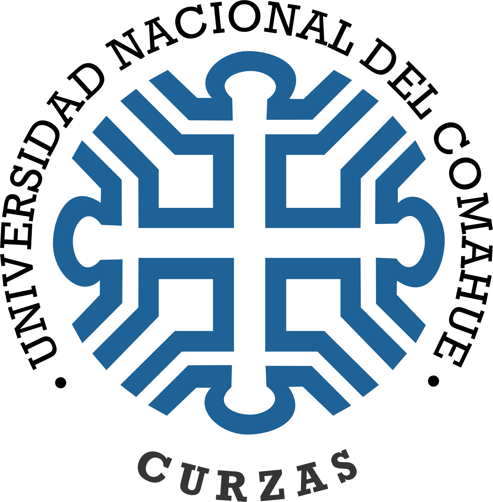

::: {align="center"}
{width=115px}

\vspace{0.4cm}

**UNIVERSIDAD NACIONAL DEL COMAHUE**  
**CENTRO UNIVERSITARIO REGIONAL ZONA ATLÁNTICA Y SUR (CURZAS)**  
**DEPARTAMENTO DE ADMINISTRACIÓN PÚBLICA**

\vspace{0.6cm}

[**DISEÑO DE UN SISTEMA DE EVALUACIÓN DEL DESEMPEÑO DOCENTE POR RETROALIMENTACIÓN DE 360° PARA LA MEJORA CONTINUA EN EL CENTRO UNIVERSITARIO REGIONAL ZONA ATLÁNTICA (CURZAS - UNCO)**]{style="color: #002B49; font-size: 14pt;"}

\vspace{0.3cm}

*Dossier Oficial de Preparación para la Defensa Oral del Trabajo Final de Graduación*  
*Marco Normativo: Resolución CD-CURZAS N° 266/23*

\vspace{0.8cm}
:::

| Campo Institucional | Detalle Académico |
| :--- | :--- |
| **Carrera** | Licenciatura en Gestión de Recursos Humanos *(Ciclo de Complementación Curricular)* |
| **Materia** | Seminario de Integración y Aplicación (SIA 2025/2026) |
| **Línea de Investigación** | Gestión del Empleo Público y Desarrollo Humano en Organizaciones Estatales |
| **Tesista / Autor** | **Tec. Sup. Héctor Daniel Ayarachi Fuentes** *(Legajo 8252 — D.N.I. 35.492.138)* |
| **Equipo Docente Evaluador** | **Dra. Deborah Noguera** *(Responsable)*, **Esp. Federico Abeiro** & **Esp. María Cecilia Aguirre** |
| **Duración Prevista** | 25 Minutos *(con versión de contingencia calibrada para 15 minutos)* |
| **Soporte Visual Oficial** | 5 Diapositivas en formato panorámico 16:9 |

```{=typst}
#pagebreak()
#outline(title: [Índice General del Dossier de Exposición Oral], indent: auto)
#pagebreak()
```

# 1. Encuadre Académico, Storytelling y los Tres Esquemas del TFG

El presente dossier reúne todos los instrumentos pedagógicos, discursivos y técnicos necesarios para la defensa oral del Trabajo Final de Graduación. Siguiendo rigurosamente las pautas de la cátedra evaluadora (Dra. Deborah Noguera, Esp. Federico Abeiro y Esp. María Cecilia Aguirre), la exposición oral se estructura como una **historia articulada en tres momentos: Inicio, Desarrollo y Final**, vertebrada a través de los **Tres Esquemas Oficiales** normados por la Resolución CD-CURZAS N° 266/23:

## La Lógica Estructural de los Tres Esquemas Oficiales
- **Esquema N° 1 — Delimitación del Objeto Problema y Objetivos:** Recorte empírico en el CURZAS (Viedma y 10 nodos). La tensión entre el régimen de control sumativo estatutario (Ord. 021/04) y la vacancia formativa, formulando la pregunta rectora y los 4 objetivos de la investigación.
- **Esquema N° 2 — Marco de Referencia Teórico y Estado del Arte:** Construcción del andamiaje conceptual para desmarcarse de recetas gerenciales corporativas: la sociología del trabajo no clásico (Enrique de la Garza Toledo), el acoplamiento sistémico entre rendimiento y desarrollo (Francisco Longo), el modelo de retroalimentación 360°, la poligobernanza universitaria con poder compartido (Matus, Cao, Oszlak) y la vacancia empírica en la Patagonia.
- **Esquema N° 3 — Estrategia Metodológica, Viabilidad y Cronograma:** La ingeniería operativa del proyecto: enfoque mixto secuencial explicativo ($CUAL \rightarrow cuan$), universo poblacional ($N \approx 173$), muestras ($n=8$ y $n=45$), matriz de viabilidad en cinco dimensiones (a costo cero incremental) y cronograma de 7 meses para el ciclo 2027.

## Cronograma Minuto a Minuto de la Exposición Oral (25 Minutos)

| Bloque | Intervalo | Momento Narrativo / Esquema | Foco Discursivo | Soporte Visual |
| :---: | :---: | :--- | :--- | :---: |
| **1** | 00:00 - 03:00 | **INICIO: El "Por qué" y 3 Esquemas** | Motivación desde RRHH, supuesto orientador y los 3 Esquemas. | Diapositiva 1 |
| **2** | 03:00 - 07:30 | **DESARROLLO (Cap. 1): Esquema 1** | Tensión Ord. 021/04, vacancia formativa, pregunta y objetivos. | Diapositiva 2 |
| **3** | 07:30 - 13:00 | **DESARROLLO (Cap. 2): Esquema 2** | Longo, De la Garza, 360°, Matus y vacancia patagónica. | Diapositiva 3 |
| **4** | 13:00 - 18:00 | **DESARROLLO (Cap. 3): Esquema 3** | Diseño mixto ($CUAL \rightarrow cuan$), universo 173 y 4 dimensiones 360°. | Diapositiva 4 |
| **5** | 18:00 - 22:30 | **DESARROLLO (Cap. 4): Esquema 3** | Cronograma 7 meses (2027) y viabilidad integral (costo cero). | Diapositiva 5 |
| **6** | 22:30 - 25:00 | **FINAL: Desenlace y Preguntas** | Contribución al CURZAS, agradecimiento y apertura al jurado. | Diapositiva 5 |

```{=typst}
#pagebreak()
```

# 2. Guion Completo del Speech Oral (25 Minutos)

> **Indicaciones para el Tesista:**  
> Las marcas temporales guían el ritmo. Las llamadas `[Pausa]` indican silencios estratégicos de 2 a 3 segundos para asimilación de conceptos. `[Énfasis]` señala modulación más pausada y grave. Las citas textuales se leen con voz clara y postura erguida.

## Parte I: El Inicio — El "Por qué" situado, el supuesto y los 3 Esquemas (00:00 - 03:00)
*Apoyo Visual: Diapositiva 1 (Carátula Oficial y Presentación del Proyecto)*

> "Muy buenos días, Dra. Deborah Noguera, profesor Federico Abeiro, profesora María Cecilia Aguirre.  
> `[Mirada serena y abierta al tribunal]`  
> Antes de adentrarme en los aspectos técnicos y metodológicos de esta presentación, quiero compartir con ustedes brevemente por qué elegí este tema y desde dónde nace esta propuesta.  
> 
> Como Técnico Superior en Recursos Humanos y estudiante avanzado de este Ciclo de Complementación Curricular de la Licenciatura en el CURZAS, siempre me apasionó comprender cómo se gestionan y se desarrollan las personas dentro de las organizaciones del Estado.  
> Al transitar nuestras aulas —y observar muy de cerca la realidad cotidiana de la cursada bimodal e híbrida que conecta a la sede central de Viedma con los diez Nodos Territoriales de la Región Sur y Atlántica rionegrina—, surgió una inquietud profesional muy concreta:  
> `[Énfasis vocal]`  
> *¿Cómo acompañamos, desde la gestión de recursos humanos, el desarrollo pedagógico continuo de nuestros docentes en una universidad pública regional?*"

> "A partir de esa inquietud, comencé a analizar el marco regulatorio vigente: el Estatuto de la Universidad Nacional del Comahue, la Ordenanza 021/04 de Carrera Docente y el Convenio Colectivo de Trabajo (Decreto 1246/15).  
> Al mirar ese andamiaje normativo, advertí que la evaluación docente hoy se estructura en informes anuales y evaluaciones periódicas cada cuatro a siete años mediante jurados externos.  
> `[Pausa - 2 seg]`  
> Esos mecanismos son fundamentales: garantizan el control estatutario y la estabilidad en el cargo.  
> Sin embargo, mi **supuesto orientador** —formulado con toda la prudencia que exige la investigación académica— es que **existiría una vacancia formativa**.  
> Es decir: estos dispositivos de control legal **no estarían devolviendo** insumos cotidianos y continuos para que los docentes mejoren sus prácticas didácticas en el aula, ni estarían alimentando de manera sistemática el Programa Anual de Capacitación y Actualización Gratuita que prescribe el **Artículo 76** de nuestro Convenio Colectivo."

> "Por esa razón decidí investigar la **factibilidad institucional de diseñar e implementar un modelo de retroalimentación de 360°** adaptado a la realidad del CURZAS para el ciclo académico 2027.  
> Quiero ser muy enfático en esto: no vengo a proponer una receta empresarial importada del sector privado con fines punitivos o salariales.  
> Vengo a indagar si están dadas las condiciones reales —normativas, técnicas, culturales y gremiales— para que una herramienta formativa y reflexiva de este tipo funcione y eche raíces en nuestra universidad pública, democrática y cogobernada."

> "Para responder a este desafío, el proyecto que hoy presento se estructura de manera natural y acumulativa a través de los **tres esquemas fundamentales** normados por la Resolución CD-CURZAS N° 266/23 y dispuestos por esta cátedra:  
> `[Gesto secuencial con las manos]`  
> - El **Esquema N° 1**, donde delimitamos el objeto problema, su justificación institucional y el sistema de objetivos;  
> - El **Esquema N° 2**, donde construimos el marco de referencia teórico, el diálogo de autores y el estado del arte;  
> - Y el **Esquema N° 3**, donde definimos la estrategia metodológica mixta situada, la viabilidad en cinco dimensiones y el cronograma operativo de implementación.  
> 
> Recorramos juntos el primer esquema."  
> `[Avance a Diapositiva 2]`

## Parte II: El Desarrollo — Capítulo 1: Esquema N° 1 — Tema, Problema y Objetivos (03:00 - 07:30)
*Apoyo Visual: Diapositiva 2 (Esquema 1: Problematización y Objetivos)*

> "Ubicamos nuestro objeto de estudio en el **CURZAS - UNCo**, con sede central en la ciudad de Viedma y una presencia territorial estratégica a través de sus diez nodos en la Región Sur y Atlántica de la Provincia de Río Negro.  
> `[Pausa - 2 seg]`  
> ¿Cuál es el diagnóstico empírico del que partimos?  
> En la universidad pública argentina, y específicamente en nuestra casa de estudios, el régimen evaluativo vigente para el claustro docente descansa fundamentalmente sobre la Ordenanza del Consejo Superior N° 021/04 y los mecanismos paritarios del Convenio Colectivo de Trabajo del sector docente universitario (Decreto Nacional N° 1246/15).  
> 
> Sin embargo, cuando analizamos este régimen desde la disciplina de la Gestión de Recursos Humanos, detectamos una **tensión estructural de fondo**:  
> `[Gesto de precisión]`  
> El sistema actual opera bajo una lógica **exclusivamente sumativa y burocrático-legal**. Es decir: evalúa la permanencia o la reválida del cargo docente cada cuatro o siete años mediante un tribunal o jurado que revisa carpetas de antecedentes.  
> 
> Pero existe un vacío institucional crítico: **la ausencia total de un dispositivo de evaluación formativa y de mejora continua**.  
> En el día a día pedagógico, el docente del CURZAS no cuenta con instancias de retroalimentación sistemática:  
> - No existe evaluación de pares pedagógicos que observen la práctica en el aula.  
> - No existe articulación con la dirección de los departamentos académicos para detectar necesidades reales de formación.  
> - La opinión de los estudiantes queda confinada a encuestas autoadministradas con bajísima tasa de respuesta y nulo impacto retroalimentador.  
> - Y lo más grave: los resultados de las evaluaciones no alimentan el diseño del Plan Anual de Capacitación y Formación Docente Continua que prescribe el Artículo 76 de nuestro Convenio Colectivo.  
> Por ende, la evaluación es percibida por el cuerpo docente como un acto de control administrativo o una amenaza punitiva, en lugar de una herramienta de desarrollo humano y pedagógico."

> "Frente a esta vacancia, formulamos la **pregunta rectora** de nuestro Trabajo Final:  
> *«¿De qué manera el diseño de un sistema de evaluación del desempeño docente basado en el modelo de retroalimentación de 360° puede contribuir al desarrollo profesional pedagógico continuo y al fortalecimiento de las capacidades institucionales del CURZAS - UNCo durante el período 2027?»*  
> 
> La justificación es triple: científico-disciplinar (aplica modelos de empleo público a la educación superior), institucional (brinda al CURZAS una herramienta propia y no punitiva) y social (impacta en la calidad formativa de estudiantes de toda la provincia).  
> 
> Para responder a este desafío, establecemos un sistema de objetivos estrictamente articulados:  
> `[Énfasis vocal]`  
> **Objetivo General:**  
> Diseñar una propuesta integral de sistema de evaluación del desempeño docente mediante retroalimentación multifuente de 360° para el CURZAS - UNCo, orientada a la mejora continua, el desarrollo profesional pedagógico y el fortalecimiento de las capacidades institucionales.  
> 
> Y para alcanzarlo, definimos **cuatro Objetivos Específicos** secuenciales:  
> 1. Diagnosticar la situación actual y las percepciones sobre la Ordenanza 021/04.  
> 2. Identificar y operacionalizar las competencias pedagógicas, comunicacionales y de gestión institucional requeridas.  
> 3. Construir la arquitectura técnica: matrices de rúbricas, ponderaciones y circuitos de retroalimentación protegida.  
> 4. Formular el plan de viabilidad y el protocolo para una prueba piloto controlada durante el ciclo académico 2027."

## Parte II: El Desarrollo — Capítulo 2: Esquema N° 2 — Marco Teórico y Antecedentes (08:00 - 13:30)
*Apoyo Visual: Diapositiva 3 (Esquema 2: Marco Teórico y Antecedentes)*

> "El abordaje de este proyecto no responde a una traslación acrítica de recetas gerenciales del sector privado. Por el contrario, nos posicionamos epistemológicamente en la concepción del **trabajo no clásico** y la sociología del trabajo de **Enrique de la Garza Toledo**.  
> El trabajo docente universitario no es una línea de montaje estandarizable: es una labor interactiva, inmaterial, donde el proceso de producción de conocimiento y aprendizaje ocurre en co-presencia con el estudiante, cargada de componentes simbólicos, éticos y contextuales.  
> 
> Por ello, nuestro núcleo teórico se vertebra a partir de tres pilares fundamentales:  
> 1. En primer lugar, el **Modelo Sistémico de Gestión de Recursos Humanos en el Sector Público de Francisco Longo (2004)**.  
> Longo nos enseña que las organizaciones públicas fracasan cuando conciben la evaluación del rendimiento de forma aislada. En nuestro proyecto, el **Subsistema de Gestión del Rendimiento** está orgánicamente acoplado con el **Subsistema de Desarrollo y Compensaciones No Monetarias**. No evaluamos para sancionar; evaluamos para diagnosticar brechas y alimentar el plan de desarrollo pedagógico.  
> 
> 2. En segundo lugar, el **Modelo de Retroalimentación Multifuente o 360 Grados** (Bernardin & Beatty; Edwards & Ewen; Lepsinger & Lucia).  
> La evaluación de 360° rompe con la asimetría jerárquica tradicional. Incorpora una mirada poliédrica:  
> - La **autoevaluación** reflexiva del propio docente (20%);  
> - La mirada pedagógica horizontal de los **pares de cátedra o de departamento** (30%);  
> - La perspectiva de los **estudiantes** (30%);  
> - Y la visión de la **dirección de departamento** (20%).  
> 
> 3. En tercer lugar, el marco de la **Poligobernanza Multinivel en Universidades Públicas**, integrando los aportes de **Horacio Cao y Josefina Blutman** junto a la sociología de las organizaciones de Henry Mintzberg.  
> La universidad pública es una burocracia profesional con poder atomizado. Como nos enseñaba **Carlos Matus**, gobernar implica gestionar el conflicto y los vectores de recursos entre actores con poder compartido. No se impone un sistema por decreto: se construye viabilidad política y legitimidad paritaria para fortalecer las **Capacidades Estatales** en el sentido de **Oscar Oszlak**."

> "Al revisar los antecedentes y el estado del arte:  
> - **Mario Rueda Beltrán (2011)** en la UNAM y **Denise Vaillant (2014)** demuestran que la evaluación formativa estimula la innovación didáctica.  
> - **Baroni et al. (2020)** ratifican la necesidad de instrumentos ágiles de acompañamiento continuo en las universidades nacionales argentinas.  
> - Y la **vacancia del conocimiento** que nuestro TFG viene a cubrir es concreta: existen estudios sobre 360° en universidades metropolitanas centrales, pero existe un vacío prácticamente total de literatura empírica sobre su aplicación en **centros regionales periféricos con dispersión territorial**, como el CURZAS en la Patagonia.  
> Este diseño se ubica temporalmente en el escenario 2024-2026 de fuerte restricción fiscal y bimodalidad pospandemia, donde optimizar las capacidades pedagógicas instaladas es un imperativo ético institucional."

## Parte II: El Desarrollo — Capítulo 3: Esquema N° 3 — Estrategia Metodológica y Datos (13:30 - 18:30)
*Apoyo Visual: Diapositiva 4 (Esquema 3: Metodología y Técnicas)*

> "En consonancia con la naturaleza aplicada de la Licenciatura en Gestión de Recursos Humanos, el presente trabajo se clasifica como una **investigación aplicada propositiva**, bajo la modalidad de **proyecto de desarrollo institucional con estudio de caso situado** en el CURZAS.  
> 
> Adoptamos un **enfoque mixto de diseño secuencial explicativo ($CUAL \rightarrow cuan$)**, asignando prioridad inicial a la dimensión cualitativa:  
> ¿Por qué esta decisión metodológica?  
> Porque la evaluación docente es sensible. Si hubiésemos implementado una encuesta cuantitativa directa, habríamos chocado contra la resistencia gremial o el sesgo de deseabilidad. Primero exploramos cualitativamente los significados y temores mediante entrevistas en profundidad; y con esos insumos, parametrizamos y testeamos cuantitativamente las dimensiones de las rúbricas."

> "Delimitamos nuestro universo en los tres departamentos académicos del CURZAS, alcanzando una población total estimada de **$N \approx 173$ sujetos** (130 docentes, 5 autoridades, 3 referentes gremiales de ADUNC y 35 estudiantes avanzados).  
> Para la muestra aplicamos dos estrategias no probabilísticas justificadas:  
> 1. Para la **Fase Cualitativa**, un muestreo intencional de **$n = 8$ informantes clave** (4 docentes con diversidad de dedicación y antigüedad, 2 directores de departamento, 1 referente gremial y 1 consejero estudiantil), buscando saturación teórica.  
> 2. Para la **Fase Cuantitativa**, un muestreo estratificado por cuotas de **$n = 45$ docentes**, garantizando representación de los tres departamentos académicos y presencia de docentes de sede Viedma y de los nodos territoriales."

> "Triangulamos cuatro técnicas e instrumentos:  
> 1. Análisis documental y normativo (Ord. 021/04, CCT 1246/15 y resoluciones CURZAS);  
> 2. Entrevistas semiestructuradas en profundidad validadas por juicio de expertos;  
> 3. Cuestionarios cerrados en escala Likert de 5 puntos autoaplicados digitalmente;  
> 4. Talleres de co-diseño participativo con docentes y directores.  
> Las dimensiones evaluativas ponderadas son cuatro: Planificación Pedagógica (30%), Clima de Aula y Relación Pedagógica (30%), Trabajo Colegiado y Gestión (20%), e Investigación, Extensión y Compromiso Institucional (20%). Todo bajo estricto anonimato y doble ciego."

## Parte II: El Desarrollo — Capítulo 4: Esquema N° 3 — Viabilidad, Cronograma y Factibilidad (18:30 - 22:30)
*Apoyo Visual: Diapositiva 5 (Esquema 3: Viabilidad, Cronograma y Cierre)*

> "Un proyecto de graduación en Recursos Humanos debe ser técnica y temporalmente realizable.  
> Diseñamos un **cronograma operativo estructurado en 7 meses de trabajo de campo**, planificado para desarrollarse entre **mayo y noviembre de 2027**:  
> - **Mes 1 (Mayo 2027):** Acuerdos político-institucionales con Decanato y Consejo Directivo, y validación de instrumentos.  
> - **Meses 2 y 3 (Junio-Julio 2027):** Fase cualitativa (8 entrevistas y análisis de contenido).  
> - **Mes 4 (Agosto 2027):** Fase cuantitativa (45 encuestas y análisis estadístico).  
> - **Mes 5 (Septiembre 2027):** Jornadas de co-diseño y validación de rúbricas.  
> - **Mes 6 (Octubre 2027):** Ensamblaje técnico del sistema 360° y redacción del protocolo piloto.  
> - **Mes 7 (Noviembre 2027):** Informe final, devolución al CURZAS y presentación de tesis."

> "La factibilidad de la propuesta se fundamenta en su **Matriz de Viabilidad en 5 Dimensiones**:  
> 1. **Viabilidad Política:** Se construye desvinculando la evaluación de consecuencias punitivas y enlazándola al Art. 76 del CCT docente.  
> 2. **Viabilidad Técnica:** Se opera sobre plataformas existentes (Moodle y Google Workspace de la UNCo), sin requerir nuevos softwares.  
> 3. **Viabilidad Económica:** **Presupuesto cero incremental**. No demanda fondos adicionales al Tesoro universitario; optimiza recursos propios.  
> 4. **Viabilidad Temporal:** 7 meses planificados respetando los recesos académicos de invierno.  
> 5. **Viabilidad Ética y Legal:** Garantiza confidencialidad, consentimiento informado y respeto pleno al CCT."

## Parte III: El Final — Desenlace, Agradecimiento y Apertura al Jurado (22:30 - 25:00)
*Apoyo Visual: Diapositiva 5 (Placa de Cierre y Agradecimiento)*

> "Para concluir, quiero enfatizar la contribución central de este trabajo.  
> Como futuro profesional de la Gestión de Recursos Humanos formado en esta universidad pública, considero que el Estado no se fortalece con controles burocráticos estériles. Se fortalece cuando genera **dispositivos de evaluación reflexiva**, que respetan la complejidad del trabajo docente y brindan herramientas reales para crecer pedagógicamente.  
> Si logramos que un docente del CURZAS —en Viedma, en Los Menucos o en Valcheta— reciba una retroalimentación formativa de sus pares, de sus alumnos y de su dirección, estaremos honrando el compromiso de la Universidad Nacional del Comahue con la calidad académica, el derecho a la educación superior y el desarrollo soberano de nuestro territorio norpatagónico.  
> 
> Agradezco profundamente la dedicación y el acompañamiento de la Dra. Deborah Noguera, del profesor Federico Abeiro y de la profesora María Cecilia Aguirre.  
> Quedo a su entera disposición para responder sus preguntas y observaciones.  
> Muchas gracias."

```{=typst}
#pagebreak()
```

# 3. Banco de Preguntas Críticas y Respuestas Estratégicas para el Jurado

A continuación se presentan las 12 preguntas más probables del equipo evaluador, junto a la argumentación teórica y normativa exacta que el tesista debe utilizar:

### P1. ¿Por qué traer un modelo de 360° del ámbito empresarial privado a una universidad pública?
**Fundamentación:** Desmarcarse del gerencialismo punitivo (Ibarra Colado) y anclarse en Longo (2004) y De la Garza Toledo. El 360° se resignifica: no para otorgar bonos o despedir, sino para democratizar la retroalimentación, superar la soledad del aula y alimentar el plan de desarrollo pedagógico continuo.

### P2. ¿Cómo evitar que la evaluación estudiantil sea un concurso de popularidad o represalia por notas?
**Fundamentación:** Tres salvaguardas: 1) Temporalidad: se aplica en semanas 10-12, evaluando el proceso formativo y no los exámenes finales; 2) Ponderación: la voz estudiantil representa el 30% y se equilibra con autoevaluación (20%), pares (30%) y dirección (20%); 3) Rúbricas comportamentales objetivadas (cumplimiento de programa, devoluciones pedagógicas, uso de Moodle).

### P3. ¿Cómo convencer al gremio ADUNC de que esto no es precarización ni persecución laboral?
**Fundamentación:** Teoría del juego social de Carlos Matus: integrar al gremio en la formulación. El sistema está totalmente desacoplado de la permanencia en el cargo (garantizada por la Ord. 021/04 y CCT 1246/15). Se articula con el **Artículo 76 del CCT**, fundamentando las demandas gremiales por mayor capacitación pedagógica gratuita.

### P4. ¿Qué ocurre con las cátedras unipersonales? ¿Quién actúa como par evaluador?
**Fundamentación:** El sistema incorpora la figura del **Par Disciplinar por Área de Conocimiento**, designado en el seno del Departamento Académico. Evalúa dimensiones pedagógicas transversales (articulación curricular, entorno virtual, materiales didácticos), no el contenido doctrinario específico.

### P5. ¿Por qué un diseño mixto secuencial ($CUAL \rightarrow cuan$) y no directamente una encuesta cerrada?
**Fundamentación:** Rigor metodológico. Un tema sensible como la evaluación despertaría desconfianza corporativa ante un cuestionario cerrado inicial. La fase cualitativa ($CUAL$) explora percepciones y vocabulario nativo; con esos insumos, la fase cuantitativa ($cuan$) parametriza y valida las rúbricas.

### P6. ¿No es escasa una muestra de 8 entrevistados cualitativos para 130 docentes?
**Fundamentación:** Muestreo intencional por máxima variación (Hernández Sampieri; Valles). La validez cualitativa radica en la riqueza y la saturación teórica de sentidos, asegurando voces de docentes exclusivos, simples, directores de departamento, gremiales y estudiantiles.

### P7. ¿En qué se diferencia de la Carrera Docente de la Ordenanza 021/04?
**Fundamentación:** La Ord. 021/04 es una evaluación **sumativa externa**, espaciada (4 a 7 años) y de dictamen binario (reválida o cese). El Modelo 360° es una evaluación **formativa interna y continua** (anual o bienal), sin sanciones, cuyo producto es un informe de retroalimentación pedagógica confidencial.

### P8. ¿Por qué se afirma que tiene "presupuesto cero incremental"?
**Fundamentación:** Distinción económica entre gasto financiero nuevo y costo de oportunidad. No se contratan softwares externos (SAP o Qualtrics) ni partidas extraordinarias: se utiliza la infraestructura instalada del CURZAS (Moodle, Google institucional y jornadas de planificación académica ya calendarizadas).

### P9. ¿Cómo impacta el modelo en los 10 Nodos Territoriales de la Región Sur y Costa Atlántica?
**Fundamentación:** El modelo opera con diseño asincrónico y baja demanda de datos móviles. Permite visibilizar y jerarquizar el esfuerzo pedagógico de la docencia en territorio, históricamente invisibilizado en los tribunales de antecedentes tradicionales.

### P10. ¿Cómo garantizar que la evaluación de pares no desate conflictos en departamentos pequeños?
**Fundamentación:** Doble ciego estricto y agregación estadística. Los informes de pares se entregan consolidados únicamente si hay al menos 3 evaluadores. Además, las rúbricas evalúan conductas observables de cooperación académica y no rasgos de personalidad.

### P11. ¿Por qué el cronograma está planificado para 7 meses en 2027 y no en 2026?
**Fundamentación:** Realismo institucional. El ciclo 2025/2026 abarca el cursado y aprobación curricular del SIA y la tramitación formal ante el Consejo Directivo. Iniciar en mayo de 2027 permite acoplar la prueba piloto con el primer cuatrimestre regular y cerrar en noviembre.

### P12. ¿Si el Consejo Directivo no aprueba el piloto en 2027, el TFG pierde validez?
**Fundamentación:** Res. CD-CURZAS N° 266/23. El TFG consiste en el diseño riguroso y viable de un proyecto de intervención institucional. Su valor científico radica en el diagnóstico, la arquitectura técnica construida y la demostración de factibilidad, quedando como un bien público para el momento institucional oportuno.

```{=typst}
#pagebreak()
```

# 4. Guía de Oratoria, Presencia Escénica y Control Emocional

> *"Creer en vos es el primer paso; trabajar por lo que querés es el segundo."*  
> — Cátedra Seminario de Integración y Aplicación (SIA)

1. **Respiración Diafragmática 4-4-6:** Inhalar 4 segundos por la nariz inflando el abdomen, retener 4 segundos y exhalar en 6 segundos por la boca. Realizar 4 ciclos antes de ingresar a la sala para estabilizar la frecuencia cardíaca.
2. **Ritmo y Cadencia (120 a 140 palabras por minuto):** En los primeros 90 segundos, hablar deliberadamente un 15% más lento. Transmite aplomo y seguridad académica inmediata.
3. **Pausas Estratégicas vs. Muletillas:** Reemplazar el *"ehhh"* o *"este..."* por una pausa de 2 segundos. El jurado interpreta el silencio como reflexión profunda.
4. **Contacto Visual Triangular:** Alternar la mirada de forma serena cada 3 a 4 segundos: Dra. Noguera (centro) $\rightarrow$ Prof. Abeiro (izquierda) $\rightarrow$ Prof. Aguirre (derecha).
5. **Protocolo ante Preguntas del Tribunal:**
   - Escuchar con atención sin interrumpir y tomar notas en papel.
   - Realizar una pausa de calibración de 2 segundos antes de responder.
   - Agradecer la pregunta: *"Muchas gracias profesora Aguirre; nos permite profundizar en un punto medular..."*.
   - Responder con la estructura: **Afirmación $\rightarrow$ Fundamentación Teórica/Normativa $\rightarrow$ Cierre Situado en el CURZAS**.
